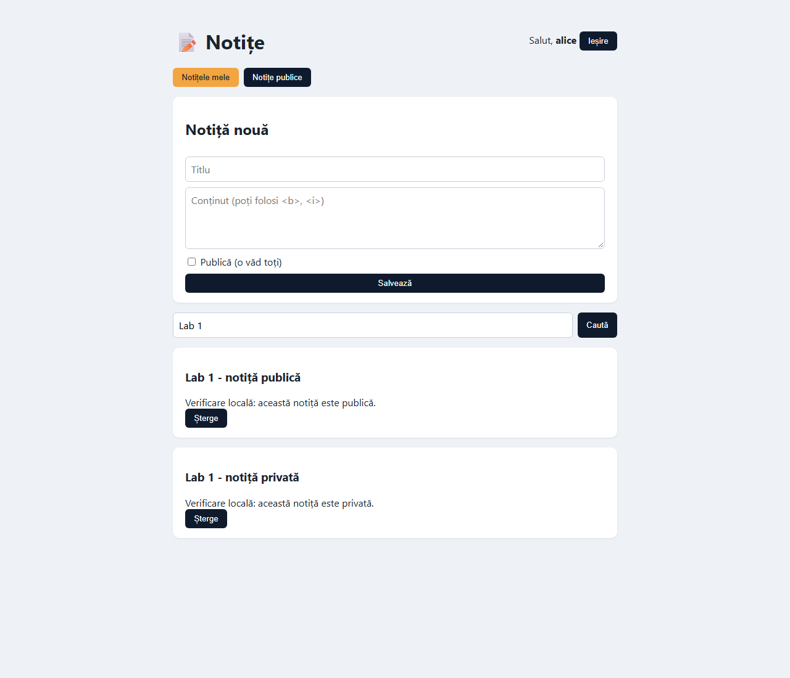
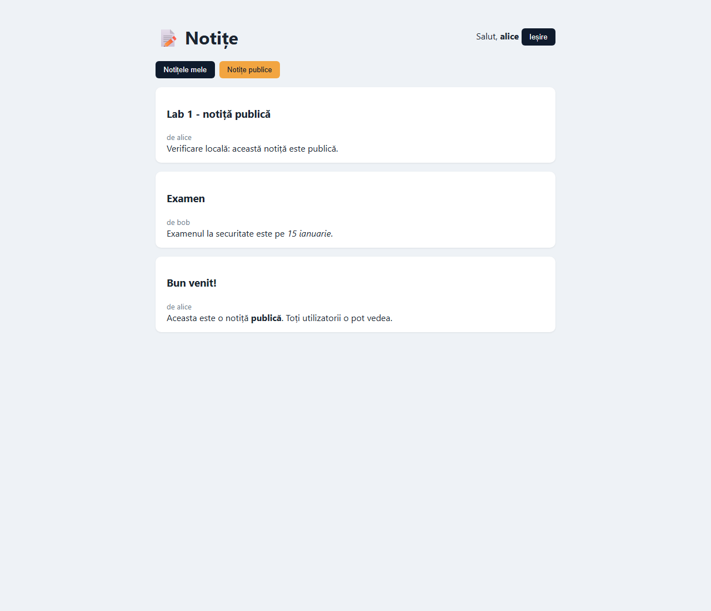
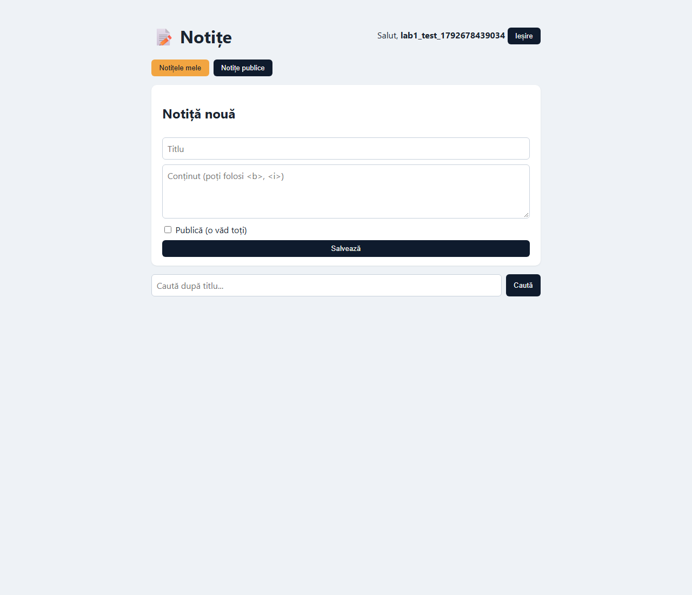
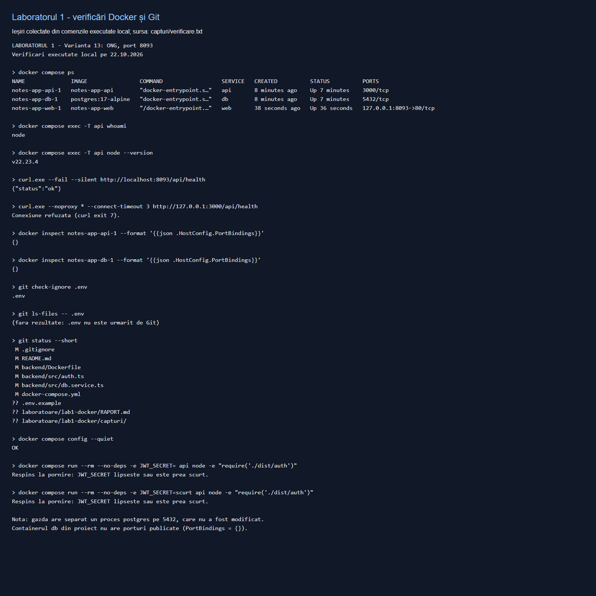

# Laboratorul 1 – Pornește aplicația și găsește riscurile

**Varianta:** 13

**Context:** ONG – notițe despre beneficiari

**Port:** 8093

**Data verificării:** 22.10.2026

**Repository:** https://github.com/Klasterov/notes-app

## 1. Scop și arhitectură

Aplicația gestionează notițe ale angajaților unui ONG despre beneficiari. Notițele pot conține date de contact, situații familiale și informații despre ajutorul acordat. Datele folosite la testare sunt fictive.

```text
Browser → localhost:8093 → web (Nginx + React, 80)
                              ↓ rețeaua internă Docker
                         api (NestJS, 3000)
                              ↓
                         db (PostgreSQL, 5432)
```

Doar interfața web publică un port pe calculator, legat de `127.0.0.1`. API-ul și baza de date comunică prin rețeaua Docker, fără publicarea porturilor lor pe gazdă.

## 2. Modelul de amenințări – Pasul 4

| Ce protejăm (activ) | Cine ar putea ataca | Ce ar putea face | Cât de grav |
|---|---|---|---|
| Parolele angajaților ONG-ului | Un atacator care obține acces la baza de date | Fură parolele și încearcă să preia conturile angajaților | Mare |
| Notițele private despre beneficiari | Alt utilizator al aplicației sau un fost angajat | Citește informații despre situația familială și nevoile unor beneficiari fără autorizare | Mare |
| Datele de contact ale beneficiarilor | Un atacator care compromite un cont | Extrage adrese și numere de telefon, apoi le folosește pentru hărțuire sau înșelăciuni | Mare |
| Conturile angajaților și identitatea lor | Cineva care află cheia JWT | Fabrică token-uri și se prezintă drept un angajat al ONG-ului | Mare |
| Integritatea evidenței ajutoarelor acordate | Un utilizator rău intenționat | Modifică sau șterge notițe, afectând deciziile privind sprijinul beneficiarilor | Mare |
| Baza de date PostgreSQL | Un atacator cu acces la un port expus și la credențiale | Accesează direct datele, le copiază sau le șterge | Mare |
| Containerul API și resursele serverului | Un atacator care exploatează aplicația | Execută comenzi; rularea ca root îi oferă drepturi maxime în container | Mare |
| Disponibilitatea aplicației | Un atacator sau un utilizator abuziv | Trimite multe cereri și împiedică angajații să consulte notițele | Mediu |

## 3. Cele patru probleme identificate – Pasul 5

| Nr. | Problemă observată inițial | De ce este periculoasă | Remediere aplicată |
|---|---|---|---|
| 1 | PostgreSQL publica `5432:5432`, inclusiv pe toate interfețele gazdei | Baza de date putea fi accesată direct de alte calculatoare dacă rețeaua și firewall-ul permiteau; acest acces ocolea API-ul | Eliminată secțiunea `ports` de la `db` |
| 2 | API-ul publica `3000:3000`; `/api/health` răspundea direct pe portul 3000 | Expunea un punct de acces suplimentar, care ocolea Nginx | Eliminată secțiunea `ports` de la `api` |
| 3 | Parola PostgreSQL era `postgres`, iar cheia JWT era `secret`, scrise în fișierele urmărite de Git | Oricine citea repository-ul cunoștea credențialele și putea semna token-uri cu cheia cunoscută | Valori aleatorii în `.env`, ignorat de Git; `.env.example` conține doar exemple; codul citește variabilele de mediu |
| 4 | `docker compose exec api whoami` afișa `root` | Compromiterea API-ului oferea drepturi maxime în container și mărea impactul atacului | Adăugat `USER node` în etapa finală a imaginii API |

Rularea ca root în container nu înseamnă automat acces root pe gazdă, dar crește drepturile disponibile unui atacator în container.

## 4. Modificări realizate – Pasul 6

- Creat `.env.example` cu `DB_NAME`, `DB_USER`, `DB_PASSWORD` și `JWT_SECRET`.
- Creat local `.env`, cu o parolă DB generată din 16 octeți aleatorii (32 de caractere hexazecimale) și o cheie JWT din 32 de octeți aleatorii (64 de caractere hexazecimale).
- Adăugat `.env` în `.gitignore`; valorile efective nu sunt incluse în raport sau în capturi.
- Configurat PostgreSQL cu variabilele din `.env`, iar API-ul cu `env_file: .env` și `DB_HOST: db`.
- Eliminat publicarea porturilor 3000 și 5432 și configurat web pe `127.0.0.1:8093:80`, conform variantei 13 și cerinței de lucru local.
- Înlocuit credențialele fixe din `backend/src/db.service.ts` cu `process.env`.
- Înlocuit cheia fixă din `backend/src/auth.ts`; încărcarea aplicației eșuează dacă `JWT_SECRET` lipsește sau are sub 32 de caractere.
- Configurat API-ul să ruleze ca `node`.
- Salvat o copie locală a bazei înainte de resetare, apoi recreat volumul și containerele conform pasului 6.5. Copia nu face parte din repository.

Pentru o clonare nouă, se copiază `.env.example` în `.env`, se înlocuiesc exemplele cu valori aleatorii și se rulează `docker compose up -d --build`. Cheile se pot genera cu `openssl rand -hex 16`, respectiv `openssl rand -hex 32`.

## 5. Verificare și capturi – Pasul 7

| Verificare executată | Rezultat |
|---|---|
| Reconstruirea imaginilor cu `docker compose up -d --build` | Reușită; backend-ul TypeScript se compilează |
| Login în browser cu `alice` / `alice123` | Reușit |
| Crearea unei notițe private și a uneia publice | Reușită |
| Căutarea după titlu | Sunt afișate cele două notițe de test |
| Tab-ul „Notițe publice” | Afișează notița publică de test; cea privată nu apare în acest tab |
| Ieșirea din cont, înregistrarea și autentificarea cu un cont nou | Reușite |
| `docker compose ps` | Numai `web` are un port publicat: `127.0.0.1:8093->80/tcp` |
| `curl http://localhost:8093/api/health` | `{"status":"ok"}` prin Nginx |
| `curl http://localhost:3000/api/health` | Conexiune refuzată |
| Inspectarea `HostConfig.PortBindings` la `api` și `db` | `{}` pentru ambele: fără porturi publicate |
| `docker compose exec api whoami` | `node` |
| `git check-ignore .env` și `git ls-files -- .env` | `.env` este ignorat și nu este urmărit de Git |
| Încărcarea modulului de autentificare cu JWT absent sau prea scurt | Eșuează cu mesajul cerut |
| `docker compose config --quiet` | Configurație validă |

În `docker compose ps`, mențiunile `3000/tcp` și `5432/tcp`, fără o mapare `adresă:port->port`, reprezintă porturile interne declarate de imagini. Acestea nu sunt porturi publicate pe gazdă.

Pe calculator există și un proces PostgreSQL separat, care ascultă pe 5432. Acesta nu este containerul bazei de date din proiect și nu a fost modificat. Pentru containerul `db`, lipsa mapării a fost verificată explicit prin `docker inspect`.

Gazda are Node.js 24; aplicația este construită și executată în imaginea Docker `node:22-alpine`, conform versiunii cerute pentru aplicație.

### Autentificare, creare de notițe și căutare



### Notițe publice



### Înregistrarea unui cont nou



### Verificări Docker, porturi, JWT și Git

Captura următoare prezintă ieșirile colectate din comenzile executate local, afișate într-o pagină de verificare. Textul sursă se găsește în [capturi/verificare.txt](capturi/verificare.txt), iar rezultatele testelor din browser în [capturi/functionalitate.txt](capturi/functionalitate.txt).



## 6. Răspunsuri la întrebările de control

**1. De ce nu trebuie urcat `.env` pe GitHub? Ce faci dacă l-ai urcat din greșeală?**

Fișierul conține credențiale și cheia de semnare JWT. Publicarea lui permite folosirea secretelor de către alte persoane. Dacă a fost publicat, consider secretele compromise și le schimb imediat: actualizez parola efectivă a rolului PostgreSQL și configurația corespunzătoare, generez o cheie JWT nouă și repornesc API-ul. Schimbarea cheii invalidează token-urile semnate cu cea veche. Scot fișierul din urmărirea Git, îl ignor și elimin secretul din istoricul publicat, coordonând rescrierea istoricului cu eventualii colaboratori. Ștergerea din ultimul commit nu elimină copiile din istoricul Git. Schimbarea doar a valorii `POSTGRES_PASSWORD` din `.env` nu modifică parola unei baze deja inițializate.

**2. Ce înseamnă „suprafață de atac” și cum ai micșorat-o?**

Suprafața de atac este totalitatea punctelor prin care un atacator poate interacționa cu sistemul. Am eliminat accesul direct de pe gazdă la containerele API și PostgreSQL și am păstrat un singur punct de intrare, Nginx pe portul 8093, accesibil doar local. Mutarea secretelor din fișierele urmărite de Git reduce și expunerea credențialelor.

**3. De ce este mai sigur ca aplicația să nu ruleze ca `root`?**

Utilizatorul `node` are drepturi mai restrânse. Dacă API-ul este compromis, atacatorul întâmpină limite suplimentare la modificarea fișierelor și la executarea operațiilor privilegiate. Aceasta aplică principiul privilegiului minim și reduce impactul unei compromiteri.

## 7. Predare

Raportul conține modelul de amenințări, cele patru probleme explicate și capturile de verificare. Repository-ul destinat predării este https://github.com/Klasterov/notes-app.

Modificările din acest laborator vizează configurarea Docker și secretele. Vulnerabilitățile didactice abordate în laboratoarele următoare necesită remedierile lor separate.
